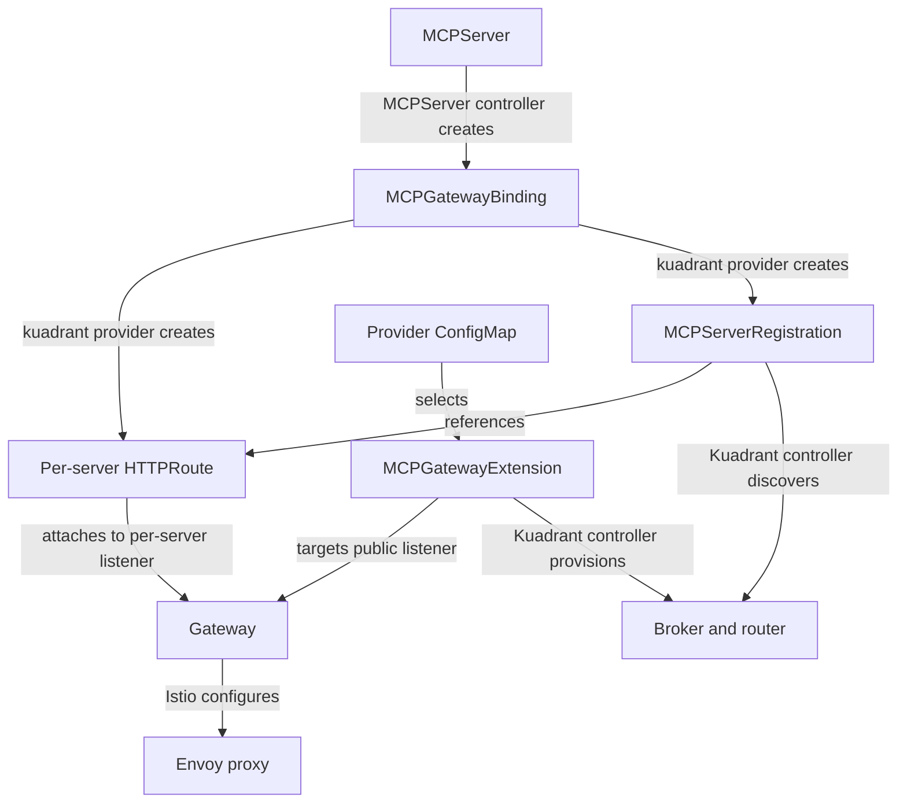
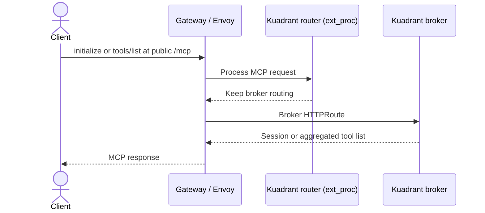

# Kuadrant MCP Gateway Architecture

The `kuadrant` provider connects MCPServer workloads to a shared [Kuadrant MCP Gateway](https://github.com/Kuadrant/mcp-gateway). Clients use one public MCP endpoint to discover tools across registered servers; the gateway routes tool calls to the appropriate backend.

This guide explains the controllers, the two listener roles, and the request paths. For the complete provider configuration, see [Gateway Integration](gateway.md#kuadrant-provider-kuadrant).

## Components and Resource Management

The MCP Lifecycle Operator manages the server workload and its registration. Kuadrant manages the broker and router. Istio translates Gateway API resources into Envoy configuration.

| Component | Responsibility | Resources it manages |
|-----------|----------------|----------------------|
| Platform administrator | Installs the gateway stack and chooses listeners and public address | Gateway, MCPGatewayExtension, provider ConfigMap |
| MCP Lifecycle Operator: MCPServer controller | Runs each MCP server and requests gateway integration | Server workload, Service, MCPGatewayBinding |
| MCP Lifecycle Operator: `kuadrant` provider | Connects a binding to the selected extension's Gateway | Per-server HTTPRoute and MCPServerRegistration, both owned by the binding |
| Kuadrant MCP Gateway controller | Provisions the MCP data plane and discovers registered servers | Broker/router Deployment and Service, broker HTTPRoute, EnvoyFilter, generated broker/router configuration |
| Istio gateway controller | Configures the Envoy data plane | Gateway proxy infrastructure and routing configuration |

The broker/router workload runs in the MCPGatewayExtension's namespace. The per-server HTTPRoute and MCPServerRegistration run in the MCPServer's namespace. Kuadrant installs the EnvoyFilter in the Gateway's namespace.



The broker serves MCP requests such as `initialize` and `tools/list` over HTTP. The router is an Envoy external processor (`ext_proc`) that interprets MCP messages and supplies routing decisions. In the standard Kuadrant deployment these run together, with broker HTTP on port 8080 and router gRPC on port 50051. The EnvoyFilter connects Envoy to the router on the configured listener port; its scope and processing rules belong to Kuadrant, rather than the lifecycle operator.

Kuadrant derives backend URLs and routing hostnames from registrations and their HTTPRoutes, then updates the configuration consumed by the broker/router. Users configure the provider ConfigMap and MCPServer; they do not maintain that generated configuration themselves.

## Two Listener Roles

The public broker hostname and backend routing hostnames serve different purposes:

| Listener in this example | Hostname | Selected by | Purpose |
|--------------------------|----------|-------------|---------|
| `mcp` | None; broker route matches `mcp.example.com` | MCPGatewayExtension `targetRef.sectionName` | Public MCP endpoint |
| `mcps` | `*.mcp.local` | Provider ConfigMap `section-name`, or wildcard discovery | Per-server routing inside the gateway |

The hostname-free public listener permits the broker route's public hostname. The wildcard listener supplies a distinct routing hostname for each server, such as `example-mcp-server.kuadrant-example.mcp.local`. [Gateway API wildcard hostname matching](https://gateway-api.sigs.k8s.io/docs/concepts/hostnames/) includes multiple labels, so that hostname matches `*.mcp.local`; it is not the same rule as TLS wildcard certificate validation.

These are separate routing roles, not a network security boundary: the per-server listener also belongs to the Gateway. Restrict access with the appropriate network controls and gateway policies.

In this pattern, keep both listeners on the **same port**. [Kuadrant's registration discovery](https://github.com/Kuadrant/mcp-gateway/blob/main/internal/controller/mcpgatewayextension.go) associates backend routes with the extension's listener port, and the session initialization path returns through that port. Using separate ports requires a different gateway design; changing only the per-server listener's port can exclude its registration from the broker's configuration.

### Listener Selection by the Lifecycle Operator

The lifecycle operator reads the extension's Gateway reference, then selects the per-server listener independently:

1. If the provider ConfigMap contains `section-name`, it uses that listener.
2. Otherwise, it selects the Gateway's single wildcard listener.
3. If there are zero or multiple wildcard listeners, it reports an error asking for an explicit `section-name`.

It never inherits the extension's `targetRef.sectionName` for per-server routes. When `route-hostname` is omitted, the wildcard suffix becomes `<server-name>.<namespace>.<suffix>`. A listener without a hostname requires an explicit `route-hostname`.

## Setup Example

This example uses HTTP for local development, with Istio already installed. For production, configure HTTPS, certificates, trust, and gateway policies using the [Kuadrant installation guide](https://docs.kuadrant.io/latest/mcp-gateway/docs/guides/how-to-install-and-configure/) and your installed Kuadrant version's documentation. The lifecycle operator's reported public URL scheme follows the extension's selected listener protocol.

### 1. Install the Controllers and CRDs

Install Gateway API, Istio, the Kuadrant MCP Gateway controller and CRDs, and the MCP Lifecycle Operator. Follow the [Kuadrant installation instructions](https://docs.kuadrant.io/latest/mcp-gateway/docs/guides/how-to-install-and-configure/) for the gateway stack and [Quickstart](quickstart.md) for the lifecycle operator.

The lifecycle operator checks required gateway CRDs at startup. If you install them after starting it, restart the operator to enable the provider. If the operator uses a trusted extension namespace allowlist, include `gateway-system` for this example; see [Production Hardening](../operating/production.md).

Create the namespaces before applying the resources below:

```bash
kubectl create namespace gateway-system
kubectl create namespace kuadrant-example
```

### 2. Create the Gateway

```yaml
apiVersion: gateway.networking.k8s.io/v1
kind: Gateway
metadata:
  name: mcp-gateway
  namespace: gateway-system
spec:
  gatewayClassName: istio
  listeners:
    - name: mcp
      port: 80
      protocol: HTTP
      allowedRoutes:
        namespaces:
          from: All
    - name: mcps
      hostname: "*.mcp.local"
      port: 80
      protocol: HTTP
      allowedRoutes:
        namespaces:
          from: All
```

`allowedRoutes` permits the server namespace's HTTPRoute to attach. For a shared cluster, use namespace selectors to limit which namespaces may attach routes. Istio provisions the gateway proxy and Service; the Service's external address depends on the environment.

### 3. Create the MCPGatewayExtension

```yaml
apiVersion: mcp.kuadrant.io/v1
kind: MCPGatewayExtension
metadata:
  name: mcp-gateway-extension
  namespace: gateway-system
spec:
  publicHost: mcp.example.com
  targetRef:
    group: gateway.networking.k8s.io
    kind: Gateway
    name: mcp-gateway
    namespace: gateway-system
    sectionName: mcp
```

Replace `mcp.example.com` with a hostname that clients can resolve to the Gateway's address. Set `publicHost` here because the public listener has no hostname. Kuadrant uses it for the broker route, whose default endpoint is `/mcp`.

The extension and Gateway share a namespace in this example. If you put them in different namespaces, Kuadrant also requires a ReferenceGrant in the Gateway namespace authorizing the extension's reference; `allowedRoutes` alone does not authorize that reference. See the [MCPGatewayExtension reference](https://github.com/Kuadrant/mcp-gateway/blob/main/docs/reference/mcpgatewayextension.md).

Wait for the extension before registering servers:

```bash
kubectl wait --for=condition=Ready mcpgatewayextension/mcp-gateway-extension \
  -n gateway-system --timeout=180s
```

### 4. Configure and Create an MCPServer

The provider ConfigMap must be in the same namespace as the MCPServer:

```yaml
apiVersion: v1
kind: ConfigMap
metadata:
  name: mcp-kuadrant-config
  namespace: kuadrant-example
data:
  extension-name: mcp-gateway-extension
  extension-namespace: gateway-system
  # section-name: mcps  # Discovered when exactly one wildcard listener exists
  # prefix: example_   # Omit to generate a prefix from the server identity
---
apiVersion: mcp.x-k8s.io/v1beta1
kind: MCPServer
metadata:
  name: example-mcp-server
  namespace: kuadrant-example
spec:
  source:
    type: ContainerImage
    containerImage:
      ref: quay.io/containers/kubernetes_mcp_server:latest
  config:
    port: 8080
    path: /mcp
  gateway:
    provider: kuadrant
    configRef: mcp-kuadrant-config
```

The operator creates `example-mcp-server-gateway-binding`, then an HTTPRoute and MCPServerRegistration with that same name in `kuadrant-example`. The route matches `example-mcp-server.kuadrant-example.mcp.local` and the `/mcp` path prefix, attaches to `mcps`, and forwards to Service `example-mcp-server` on port 8080. The registration references that HTTPRoute, sets the MCP path and prefix, and enables discovery.

The default tool/prompt prefix is `mcp_<hash>_`, using a short hash of the server name and namespace. The `example_` prefix used in the request example below requires explicitly setting `prefix: example_` in the ConfigMap. Prefixes must not conflict with another registration.

## Request Paths

The following describes Kuadrant's MCP **2025-11-25 session flow**. Protocol handling evolves independently of the lifecycle operator: newer stateless protocol support can route calls without backend session initialization. Consult the [upstream routing implementation](https://github.com/Kuadrant/mcp-gateway/tree/main/internal/routing) for your deployed version.

### Discovery and Tool Listing

During discovery the broker connects to registered backend URLs to learn their tools. Those connections can go directly to backend Services; they are separate from the gateway's client request routing. The broker aggregates discovered tools under their registration prefixes.



### Tool Calls and the Internal Hair-Pin

A tool call uses the router to choose a backend. For example, with `prefix: example_`, a call to `example_get_pods` selects this registration; the backend receives the tool name `get_pods`.

If the router has no backend session for the client/server pair, it initializes one through the Gateway's cluster-internal Service. This extra request is the **hair-pin**: it re-enters the gateway from inside the cluster, allowing applicable gateway policies to run. It uses the backend routing hostname, without requiring DNS for that hostname to resolve to a server pod.

```mermaid
sequenceDiagram
    actor Client
    participant Envoy as Gateway / Envoy
    participant Router as Kuadrant router (ext_proc)
    participant Backend as MCP server Service
    Client->>Envoy: tools/call example_get_pods at public /mcp
    Envoy->>Router: Process tool call
    Router->>Router: Find registration and backend session
    opt Backend session missing
        Router->>Envoy: Initialize via internal gateway Service
        Note over Router,Envoy: Internal hair-pin; router selects backend hostname
        Envoy->>Backend: Backend initialization
        Backend-->>Envoy: Backend session
        Envoy-->>Router: Initialization response
    end
    Router-->>Envoy: Backend authority, session and unprefixed tool name
    Envoy->>Backend: Per-server HTTPRoute; tools/call get_pods
    Backend-->>Envoy: Tool result
    Envoy-->>Client: MCP response
```

The original tool call is routed by Envoy to the backend after processing; it does not need to pass through the broker HTTP endpoint. The hair-pin is an additional session initialization exchange, not a second broker-generated tool call. Gateway policies apply according to their configured targets and rules; creating the extension does not itself configure authentication or rate limiting.

## Verify the Integration

```bash
kubectl get mcpgatewaybindings -n kuadrant-example
kubectl describe mcpgatewaybinding example-mcp-server-gateway-binding -n kuadrant-example
kubectl get httproute example-mcp-server-gateway-binding -n kuadrant-example -o yaml
kubectl get mcpserverregistration example-mcp-server-gateway-binding -n kuadrant-example -o yaml
kubectl get mcpserver example-mcp-server -n kuadrant-example -o jsonpath='{.status.address.url}'
```

The binding reports `Registered=True` only after the extension is ready, the route has current `Accepted=True` and `ResolvedRefs=True` conditions for the Gateway, and the registration is ready. Its message identifies which dependency is pending. With this example's configuration, the public address is `http://mcp.example.com/mcp`.

Connect an MCP client to that endpoint, initialize it, list tools, and call one of the returned tools. If a server is missing, check the registration and broker discovery logs. If listing works but a call fails, check the per-server route, router logs, backend connectivity, and any policies on the internal initialization path. See [Kuadrant troubleshooting](https://docs.kuadrant.io/latest/mcp-gateway/docs/guides/troubleshooting/) for gateway-specific diagnostics.

Removing `spec.gateway` deletes the binding and its owned HTTPRoute and registration. The shared Gateway and MCPGatewayExtension remain managed by the platform administrator.
